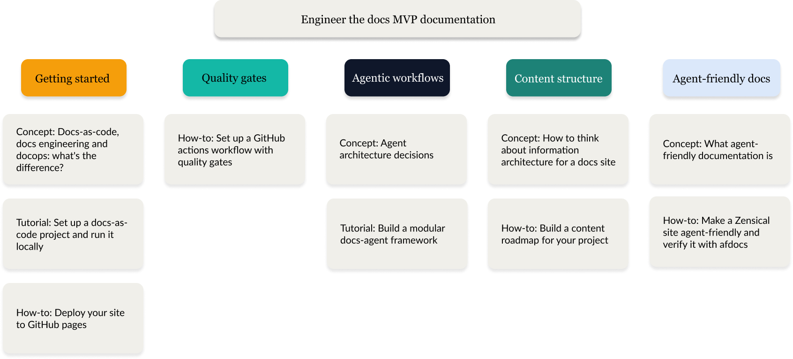

# My projects

## 1. Engineer the docs website

"Engineer the docs" is a live docs-as-code site built with Zensical (the MkDocs successor from the Material for MkDocs team), deployed to GitHub Pages.

### Current state

The pipeline and site are live and operational:

- [X] Site deployed to GitHub Pages
- [X] Three-job GitHub Actions workflow: lint-and-validate → build → deploy
- [X] markdownlint integrated as quality gate 1
- [X] Vale integrated as quality gate 2, with PR annotations
- [X] Built three AI agents using Groq's API and basic Python: terminology consistency checker, SEO heading optimizer, and alt text generator
- [X] Two published articles live on the site

Vale is configured via `.vale.ini` at the project root, with synced style packages in `.github/styles`. 

The repo's commit and PR history is intentionally visible to hiring managers, so branching strategy and PR quality are treated as part of the portfolio artifact.

### On the horizon

In the current pipeline plan, content design feeds drafting, pull requests trigger quality gates, a human reviews the work, AI agents intervene at certain points, and  the site is built and deployed. Then, observability and reader feedback are collected and integrated into the next content decision.

The following is a documentation roadmap:

Based on the recommended content roadmap, next priorities are likely the following:

- [ ] Build four AI agents using Groq's free API and basic Python.
- [ ] Remaining MVP articles in the "must ship" core that demonstrate the full DocOps loop: 
  - [ ]  How-to: Deploy your site to GitHub Pages
  - [ ]  How-to: Set up a GitHub Actions workflow with quality gates
  - [ ]  Concept: Agent architecture decisions
  - [ ]  Tutorial: Build a modular docs-agent design pattern
  - [ ]  Concept: Thinking about information architecture for a docs site
  - [ ]  Build a content roadmap for your project
  - [ ]  Cooncept: What agent-friendly documentation is
  - [ ]  How-to: Make a Zensical site agent-friendly and verify it with `afdocs`

- [ ] Make my documentation website adherent to the AI-agent friendly documentation specification: https://agentdocsspec.com/spec/
- [ ] Additional quality gates from the planned stack: front matter validation, Doc Detective (functional checks), Lychee (link checking, check if needed as it seems Zensical has this functionality built-in), Pa11y / readability scoring
- [ ] Docs observability and metrics sections — post-publish, reactive tooling

After every session, when I ask "recap this session", write a daily log note. Use the `daily-note-template.md`

## 2. Engineering the docs blog entries

I write a blog which serves as the narrative layer on top of my portfolio website. Is where I document why I made the decisions I made, what broke, what I learned. The site is the finished artifact; the blog entries are the reasoning trail. For this purpose, I record every day what I build, the decisions I made, blockers, and how I fixed them, etc. I structure the information following the `daily-note-template.md`

### Audience

Hiring managers evaluating whether I can operate as a documentation engineer, not just a technical writer.