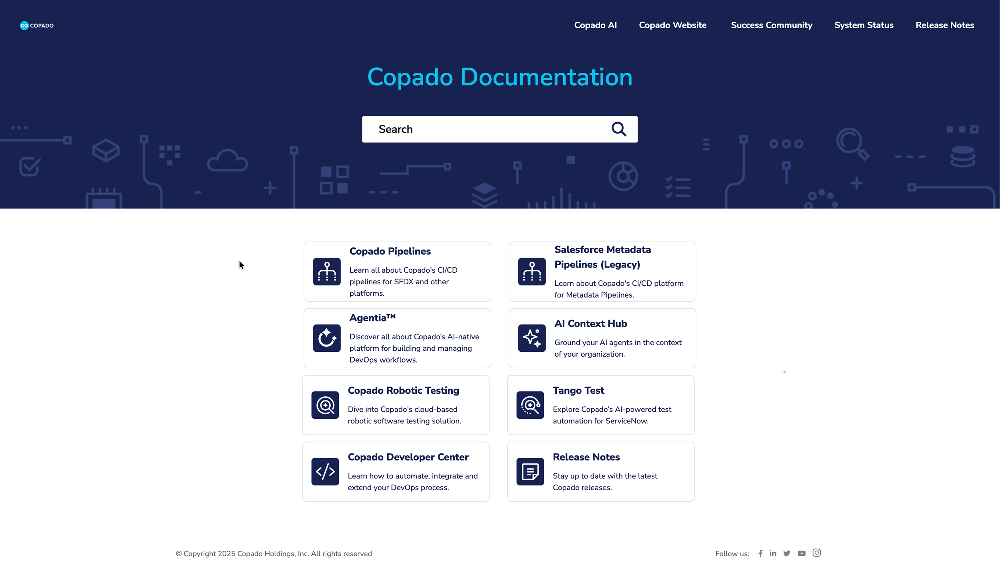
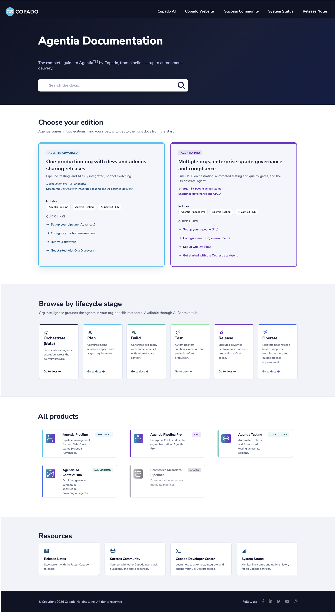

## Summary

Copado's documentation homepage assumed readers already knew where to go: a flat grid of eight product cards, a legacy product sitting beside current ones, and generic descriptions. I spotted the gap, built the new homepage on my own initiative, and took it through feedback and sign-off from marketing, product, and UX design before it went live. I restructured the page into four sections (edition, lifecycle stage, product index, resources) built around the questions readers arrive with, wrote all the microcopy in a consistent verb-first docs register, and ran a full WCAG 2.2 AA audit, resolving every failure it found. I also authored the HTML and CSS for the ClickHelp portal, across sandbox and production.

I used Claude grounded in Copado's marketing decks and connected to the in-house design system through MCP. The page now reflects a six-agent architecture that the previous version didn't have.

- Role: Technical writer
- Company: Copado
- Product: Agentia
- Timeline: August 2026
- Stack: ClickHelp, HTML/CSS, Copado design system, Claude (via MCP)

## Problem 

The previous documentation homepage assumed readers already knew where to go. It was a flat grid of eight product cards with no way to orient someone new to Copado, a legacy product sitting beside current ones, and generic descriptions that didn't say what each product does.

{: .rounded }

*The documentation home page before the redesign*

## Approach

- Mapped the page to four reader needs. Each section answers a different question: which docs apply to my edition, and how do I get started (Choose your edition); how do I use the DevOps AI agents (Browse by lifecycle stage); where is a specific product (All products); and where do I find releases, community and support (Resources). Search sits above all four for readers who already know what they want.
- Treated naming as a single source of truth. I reconciled the naming and packaging architecture with the Agentia Messaging Framework, keeping concrete specifics and filtering out promotional language, so docs don't contradict marketing or sales.
- Defined a reusable copy pattern. Verb-first, function-before-brand descriptions are applied identically across six agent cards and two edition cards. Adding a seventh agent means filling in the pattern, not reinventing it.
- Built accessibility into the system. A full WCAG 2.2 AA audit led to a --purple-text token that fixes contrast without breaking the decorative palette, plus distinct aria-labels per card and sticky-header scroll padding, all checked against the in-house design system.
- Worked within platform constraints. I debugged stylesheet conflicts in ClickHelp, including injected styles overriding the page CSS and a logo max-height override, across sandbox and production. 

## How I used AI and where I kept control

I used Claude throughout the project, with constraints on what it could use and what it could ship.

- Grounded in source material. I gave Claude the Agentia, Advanced and Pro marketing decks, so product names, packaging and positioning came from the source of truth rather than from the model's assumptions.
- Constrained by the design system. I connected Claude to Copado's design system through MCP, so generated markup and styling followed the system instead of generic defaults.
- Used for benchmarking. Claude helped me analyze the homepages of Stripe, Twilio and Dynatrace for structural patterns and gaps, which I turned into a proposed structure and iterated on.
- Held to a factual standard. I rejected copy that sounded like marketing promotion and wasn't grounded in a factual description of what a product does.
- Gated by people. Once structure, information and messaging held up, I added links to product articles and took the prototype through feedback and sign-off from marketing, product, and UX design.

The same rule governs the page and the process: every claim has to trace back to a source.

## Results

The redesigned documentation homepage delivers the following:

- A six-agent architecture (one agent in beta) that the previous page didn't reflect.
- WCAG 2.2 AA conformance, where the page was previously unaudited.
- A shared copy pattern that lowers the maintenance cost of future updates.
- Alignment with the official messaging, which reduces the risk of docs contradicting marketing and sales materials.

{: .rounded }
*The documentation home page after the redesign*
