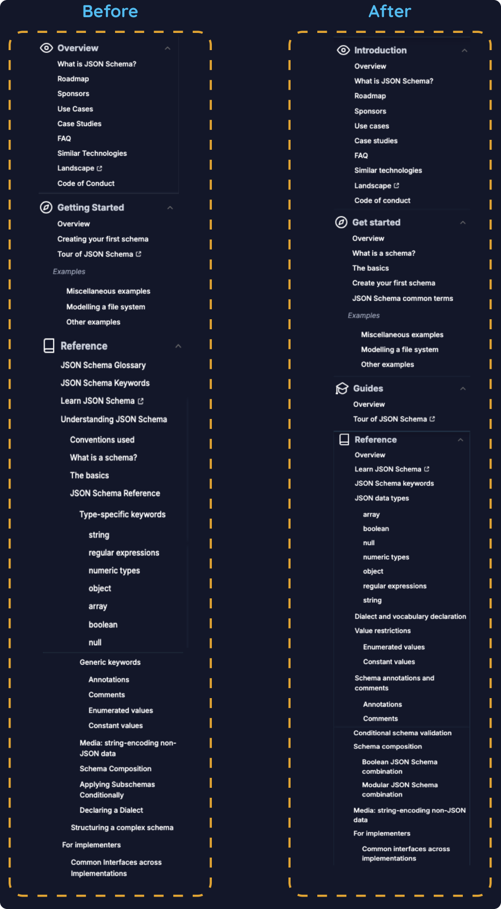

## Summary

JSON Schema's documentation had grown fragmented: inconsistent style, deep navigation, and no standards for contributors. During Google Season of Docs 2024, I audited 48 pages, redesigned the information architecture around a customized Diátaxis model, wrote the documentation style and contributing guides, and shipped the new structure to the live site in the Next.js codebase, including 301 redirects so existing links kept working.

I merged five PRs, anchored by two: the [style and contributing guides](https://github.com/json-schema-org/website/pull/1013) (Oct 2024) and the [IA implementation](https://github.com/json-schema-org/website/pull/1411) (Mar 2025).

- Role: Technical writer
- Program: Google Season of Docs 2024
- Open-source project: JSON Schema
- Timeline: May 2024 – Mar 2025
- Stack: Next.js, Tailwind CSS, Git/GitHub, Netlify, Figma

{: .rounded }

*The sidebar before and after the revamp.*

## Problem

The documentation had four main problems:

- Style, terminology, and formatting varied from page to page, so the docs read as fragments.
- Reference pages nested up to four levels deep, which buried foundational content such as "What is a schema?" and "The basics."
- No documented standards existed for writing or maintaining docs.
- Many sections gave no context about who they were for or what to expect.

## Approach

### 1. Audit the content and design the content model

I inventoried 148 pages and tagged each one by documentation type, developer journey stage, and audience. The audit showed how lopsided the content was: of the pages I classified by Diátaxis type, 22 were reference, compared with 2 tutorials and 1 how-to guide.

I organized the content around a customized Diátaxis model with four sections: Introduction, Get started, Guides, and Reference. A fifth section, [Specification](https://json-schema.org/specification), was maintained separately by a colleague and was outside the scope of this project.

Each section opens with an overview page that states its purpose and sets expectations before the reader commits.

{: .rounded }

*Overview pages at two levels: a content bucket and a section with nested documents.*

### 2. Build the standards that keep the structure intact

I wrote the documentation style guide and a contributing guide so new contributors can work without a maintainer's help.

- The style guide sets sentence-case titles, noun-first names for reference pages, and verb-first names for guides.
- The contributing guide, built from Good Docs Project templates, walks through the whole workflow: finding and claiming issues on the docs board, file and branch naming, opening PRs, and requesting review.

### 3. Implement the new IA on the live site

The implementation PR changed 33 files (+718/−349). It did the following:

- Reworked the sidebar navigation component.
- Built a new Guides section for future hands-on content.
- Rebuilt the Get started section by moving foundational content out of Reference.
- Added descriptions of what each section holds to section's landing pages and parent pages.
- Retitled cards and navigation links to match the naming system.
- Relinked previous/next navigation across the reference pages.
- Shipped 301 redirects so existing URLs and inbound links kept resolving.

### Collaboration

I led and implemented the new information architecture. With my GSoD colleagues, I built the JSON Schema keywords index (within Reference, linking each keyword to its documentation), which didn't exist when I joined, and I mapped user journeys to inform the design. The maintainers reviewed and merged the PRs.

## Results

The new architecture delivers the following:

- Reference nesting reduced from four levels to two.
- A rebuilt Get started section and a new Guides section that give beginners and hands-on learners dedicated entry points.
- An overview page at the top of every section.
- A documented style guide and contributing workflow, with a clear path for new contributors.
- Existing links preserved through 301 redirects.

## Decisions and trade-offs

- Customizing Diátaxis: I mapped Get started to tutorials, Guides to how-to content, and Reference to reference. Introduction has no Diátaxis equivalent. I kept it as its own section for newcomers and decision-makers who are evaluating JSON Schema before they learn it. The audit's imbalance (22 reference pages against 3 tutorials and how-tos) is why Get started and Guides needed dedicated sections.
- Overview pages: Every entry point has to work as "page one" for a reader who arrives from search, so sections state their purpose and audience up front.
- URLs: I accepted the extra migration work of redirects over breaking inbound links, because existing links are part of the documentation's value.
- A maintainability cost I'd fix: The navigation structure lives in several places (the sidebar component, landing-page cards, and each page's previous/next frontmatter), so adding a page means editing several files.

## What I'd do next

Generate navigation and previous/next links from a single source, and enforce the style guide automatically with linting and link checks in CI. This is the direction I'm taking in [Engineer the Docs](https://valeriahhdez.github.io/engineer-the-docs/).