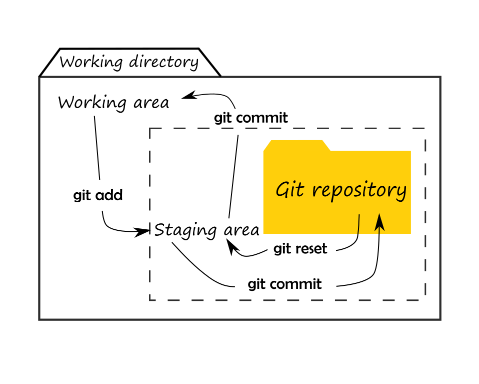
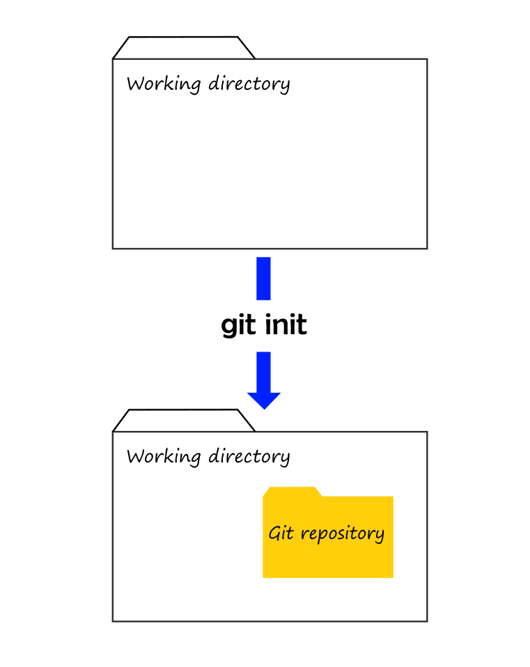
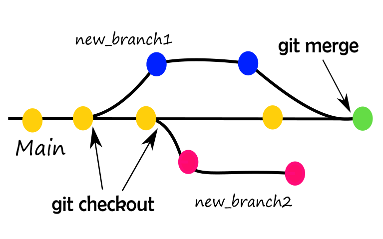
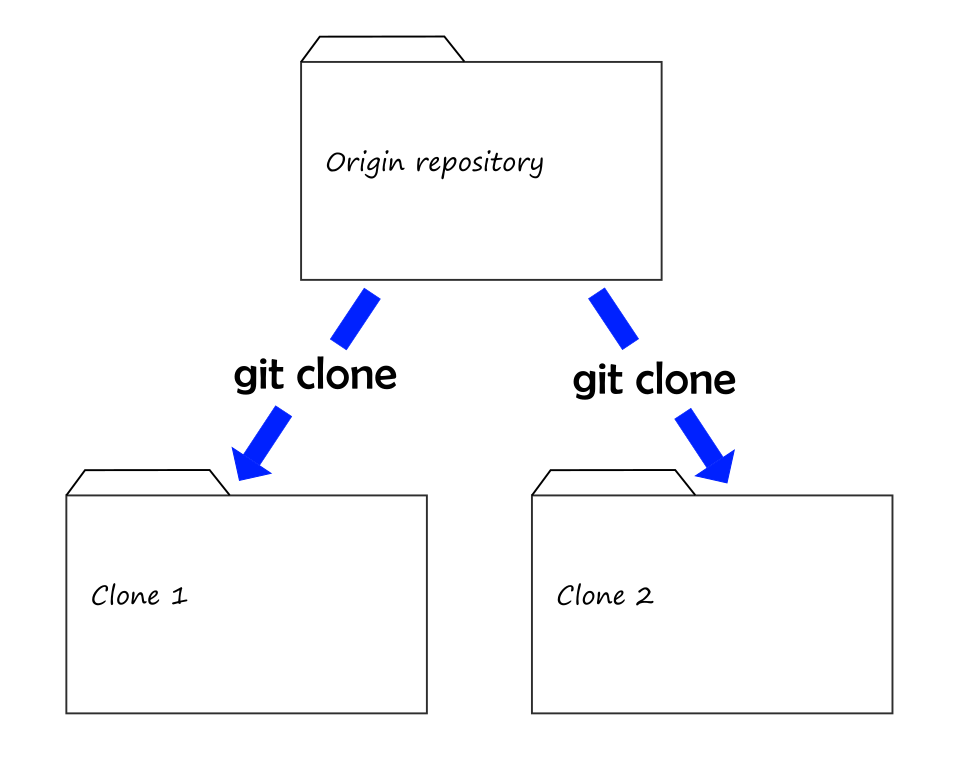

In April 2022, I joined the Write the Docs Slack Channel, and right off the bat, I joined my first book club. I was looking for resources to learn Git, so finding out that the book club was about "Learn Git in a month of lunches" by Rick Umali was a fortunate stroke of serendipity.

Progressing at a pace of around two chapters per week, it took almost nine weeks to peruse the book. The book is an excellent step-by-step walk-through of Git and Umali has a simple and effective way to teach how to work with Git using the Git Bash and the Git GUI. Every chapter contains graphic illustrations, screenshots, hands-on exercises, and labs to delve deeper.

In this post, I explain what I learned from the book with a concept map.

## What is a concept map?

In this section, I explain what a concept map is (not to be confused with mind maps). If you are already familiar with concept maps, you can skip to the next section.

A concept map is a graphical tool that uses concepts and relationships to represent knowledge that answers one or two focus questions. We use boxes or circles to illustrate concepts and lines to represent their relationships. So far, this description does not differ much from a mind map, so here is the first distinction: the relationships between concepts have linking words or phrases. Connecting concepts with linking words produces meaningful statements.

Another distinctive characteristic of concept maps is that they are hierarchical, with the most general concepts located at the top of the map and the most particular ones at the bottom. We also structure texts hierarchically, which is why concept maps can help organize knowledge into a coherent structure. Describing a concept map in written words should render a logically consistent and well-structured text.

Linking words and hierarchy are my favorite features of concept maps and why I prefer them over mind maps to represent knowledge.

## Concept map focus questions

The focus questions I tried to address in this concept map are the following:

- What is Git?
- How does Git work?

I will explain the map following the hierarchical structure and add information and figures wherever pertinent. 

## A concept map to explain the basics of Git

{: .rounded }

Git is a distributed version control system. But what is a distributed version control system? I will first explain what a version control system (VCS) is.

VCS is software for tracking and managing the changes made to a file or group of files (i.e., a project) over time. 
You save changes in a Word document by clicking a button that overwrites the changes on your file. But saving file changes in Git is broken down into two steps. 
First, you tell Git to track (or stage) a file with the command `git add`. Second, you save your work with the command `git commit`.

Git sees every file in your working directory as one of three things:

- **Tracked**: a file that has already been staged.
- **Untracked**: a file that has not been staged.
- **Ignored**: a file that Git has been told to ignore.

Files (or changes) "move" among three different areas. The command `git add` moves files from the working area to the staging area where Git can "see" them. 
When your changes are ready to be saved, `git commit` moves them to the Git repository. You can reverse this flow from the Git repository to the staging area with `git reset` and from there to the working directory with `git commit`.

{: .rounded }

What are the working directory and the Git repository?

Git tracks and manages changes in a directory called Git repository. In Git, we refer to a working directory as the local directory that contains the files of the project you are currently working on. 
The Git repository is created with the command `git init`, which is a hidden directory inside the working directory. Creating a Git repository is the first step when working with Git.

{: .rounded }

Committing changes in Git creates a snapshot of your project that is saved in a timeline, called commit history. Git assigns a unique identifier to each commit, the SHA1 ID, and asks you to add a descriptive message of the changes. 
Also included in the commits are the author's name, email address, and time of creation. You can access the commit history and all this information with the command `git log`.

With the commit history and SHA1 ID, you can use Git like a time machine. If you ever need to use a previous version, you can use the SHA1 ID to point Git to the version of your project you want to revert to. 
If you want to compare the differences between versions to decide which one to use, you can use the SHA1 IDs and `git diff`. After determining the point you want to return to, you can start a new development path from there.

{: .rounded }

The Git time machine lets you to break the continuum of your main developmental path with a new one, called a branch. Every Git repository comes with a branch called `main`. 
You can start a tangent branch to test changes without affecting your project. Create as many branches as you want and save them in your Git repository with `git switch -c +[branch-name]` or `git checkout +[branch-name] -b`. If the changes of the new branch deserve to live in the main branch, use the command git merge to incorporate the new branch into main. 
Switch between branches with `git switch [branch-name]` or `git checkout [branch-name]`.

Now it's time to regturn to the definition of Git and explain when a VCS is distributed.

A VCS is distributed when each collaborator can create a copy of the original repository (which we call origin) and have the same capabilities as everyone else. 
In Git, collaborators have total access to a repository's history, can create any number of branches, and perform any operation without special requirements. 
The command `git clone` clones repositories.

{: .rounded }

Local and remote repositories are relative terms. The local repository is in your computer. The remote repository (or origin) is the one where you send the changes. 

Suppose the project you're working on has another collaborator, John. You both work on your respective local repositories, but John has sent his changes to the origin repository first. 
How do you update your repository with the latest changes John sent to the origin repo? And how do you send your changes to origin so that John can also update his local repo with your changes?

You both need to synchronize your local repositories. 

Syncing the local and remote repositories is a two-step process. The `git push` command publishes your local changes to a remote repository. In contrast, `git pull` lets you pull changes from a remote repository. `git pull` is further divided into two steps:

1. Git retrieves (fetches) the upstream changes and laids them on top of your repo. You can do this yourself with `git fetch`.
2. Git merges the fetched changes into your local repo. The command for this step is `git merge`.

Commands like `git fetch` and `git merge` come in handy when a commit conflict occurs. If you and John have modified the same lines of a file, called commit conflict, Git cannot determine what is correct and will ask you to solve the conflict. 
You must to use the `git fetch` command to retrieve the changes. Then use `git diff` to see the differences between your changes and John's and decided how to solve the commit conflict. After that, you can `git merge` to complete the syncing process.

And that's all. That's the basics of Git. 

## What is Git? How does Git work? 

Here's a summary of what we covered:

- Git is software to track and manage changes to files.
- Git is distributed, meaning that collaborators can clone repositories and have complete control over their local repository.
- Git allows people to collaborate by syncing updates among repositories.
- Git is like a time machine that can take you to previous versions of your repository and allows you to create tangent developmental paths.

## Final thoughts

To keep this map concise, I skipped many important things about Git. Choosing what to keep wasn't easy. But I hope I achieved my goal of explaining clearly and concisely what Git is and how it works.

I invite you to keep learning about Git. Resources are abundant on the internet, but here are a few personal recommendations:

Book: [Learn Git in a month of lunches by Rick Umali](https://www.manning.com/books/learn-git-in-a-month-of-lunches).

Game: [Oh, my Git](https://ohmygit.org/?ck_subscriber_id=1585074308).

Finally, I hope this example illustrates how helpful concept maps are and that you now feel curious to try them. 
I enjoy organizing information into coherent structures. 
Building this concept map not only was fun, but it helped me create a mental model of Git and cemented what I learned from the book. 
