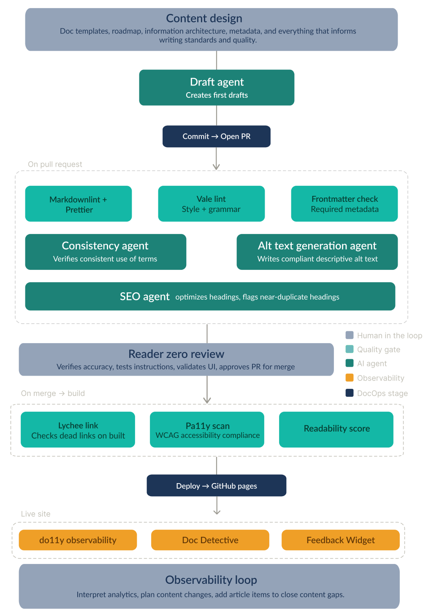

*This is part of a series where I document building my own docs site from scratch as I go from tech writer to docs engineer, building AI-assisted documentation pipelines.*

I'm building Engineer the docs to go from writing documentation to engineering the systems (AI included) and architecture that write it with me in the loop.

I already had plenty of ideas for this project. The problem was that they were behaving less like a plan and more like a beehive in my head.

So I dumped them all onto one page and connected the dots. 
The result is the mental model below: content design feeds drafting; pull requests trigger quality gates; a human reviews the work; some tasks are automated with AI agents; the site is built and deployed; then observability and reader feedback are integrated into the next content decision.

Visualizing this mental model also revealed my skill gaps.

I need to deepen my experience with automation and quality gates. 
I want to grow into agentic workflows, observability, search optimisation, analytics and metrics, user testing, and feedback systems.

The result is not a fixed roadmap. It is a north star with several parts still labelled “here be dragons.”

{: .rounded }

I'm not building a polished documentation site merely to prove I can build one. I'm building the operating system around it because it feels the most natural next step in my career.

I'm writing this series of articles to help me cement what I learn and to record my strategic decisions. Future self: you're welcome.  

If you find it useful, follow along. It's free.

Next up: building a logo and a brand identity for the project. 
